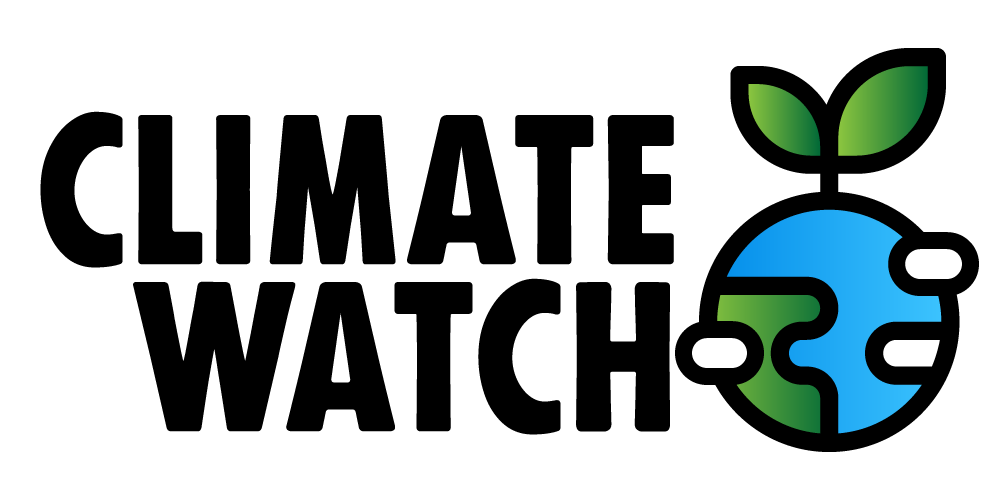

# Climate Watch — climate data analysis

Climate Watch is a data science case using historical global temperature datasets. Describe the case and your approach in a Jupyter Notebook, analyze the data, and combine notebook results with a Power BI dashboard and a final report. The exercise uses tools and languages studied in the course to help develop and demonstrate data analysis skills.

Source material: [case introduction](https://e-learning.educom.nu/cases/climate-watch/) and [assignments](https://e-learning.educom.nu/cases/climate-watch/opdrachten). The climate data is also linked on [Kaggle](https://www.kaggle.com/datasets/berkeleyearth/climate-change-earth-surface-temperature-data); the case provides a local ZIP copy in [`assets/`](assets/).

## Dataset

The case describes the data as a Berkeley Earth compilation of 1.6 billion temperature reports from 16 existing archives, affiliated with Lawrence Berkeley National Laboratory. It combines measurements from historical sources and station records, whose methods and locations changed over time. The brief calls out mercury thermometers and variation in observation time, weather stations moved during airport construction in the 1940s, and a shift to electronic thermometers in the 1980s that is reported to have a cooling bias. Consider these caveats when cleaning and interpreting trends; do not treat the measurements as free of uncertainty.

The provided files include:

- Global land and land-and-ocean temperatures. Land average temperature begins in 1750; land maximum/minimum and land-and-ocean series begin in 1850.
- Average, maximum, and minimum land temperature in Celsius, with corresponding 95% confidence intervals (uncertainties).
- Average land temperature by country, state, major city, and city.

The source data and transformation code are published by [Berkeley Earth](http://berkeleyearth.org/data/). The case also links a [Guardian article about microplastics and plant photosynthesis](https://www.theguardian.com/environment/2025/mar/10/microplastics-hinder-plant-photosynthesis-study-finds-threatening-millions-with-starvation) as additional climate related reading.

## Setup and tools

Work in a Jupyter Notebook in the `climate-watch` directory. The case suggests the VS Code [Jupyter Notebook support](https://code.visualstudio.com/docs/datascience/jupyter-notebooks) and these Python packages:

- SQLAlchemy
- pandas
- numpy
- seaborn
- plotly
- matplotlib
- geopandas

The assignment's database step uses MySQL and creates a database named `climate_watch`. Document any additional dependencies or external tools in your project README.

## Assignment sequence

Create a repository called `climate-watch`, create issues for the assignments, and keep them in a project plan. Commit and push work twice each day, around 12:00 and 17:00, even when an assignment is incomplete, so instructors can follow progress and work is backed up.

### 1. Database

- Create the `climate_watch` MySQL database and tables based on the CSV files.
- Import all data files and export the database as an SQL backup.
- Export the empty table definitions into the repository's `database/` directory.
- Add source CSV files and database tables containing the imported data to `.gitignore`; the full files are too large to push.

### 2. Notebook and subset

Run a Jupyter server from the `climate-watch` directory. For faster experimentation, make a consistent subset, for example records from 1980 onward. The brief says this smaller subset may be committed so some source data remains available in GitHub.

### 3. Cleaning and missing values

Inspect missing values by row and by column. Consider removing incomplete records, using a documented default, or replacing missing values with nulls. Evaluate the risks of dropping rows or columns in long-term climate series. The brief cautions that substituting zero can be misleading and suggests a column mean as one possible imputation approach. Explain and justify the strategy chosen.

### 4. Exploration and analysis

- Use `df.describe()` or similar methods to explore mean, median, standard deviation, and other summary statistics.
- Examine temperature distributions by year or century and visualize global average land temperature over time.
- Compare country averages; identify and visualize the warmest and coldest countries.
- Analyze city and major-city trends, compare cities, find the largest temperature differences, and chart selected cities over time.
- Analyze where and when uncertainty is high or low, whether it changes over time, and how land and ocean uncertainty compare.
- Use latitude/longitude or country names for geospatial views such as Plotly `scatter_geo` or a country/region choropleth.

### 5. Power BI dashboard

Export calculated dataframes to separate CSV files and build a dashboard with views for:

1. Global average land and land/ocean temperatures over time.
2. The ten countries with the highest and lowest average temperatures, plus a selected country's average temperature trend.
3. The ten major cities with the largest temperature differences, plus a selected city's trend.
4. Uncertainty analysis.
5. Average city temperatures on a world map.

The source asks for the world map view and also mentions it as an alternative, more polished view; choose a clear dashboard layout that communicates the analysis.

### 6. Final report and bonus analysis

Create Markdown report files in `reports/` that combine the notebook and Power BI results, charts, key findings, trends, and data problem areas. Compare post-1980 temperature increases across countries, cities, and continents against pre-1980 data. Describe what stands out and possible explanations. Link the final report from this README.

**Bonus:** Find country-level datasets for CO₂ emissions, deforestation, population growth, industrial production, energy use and energy sources, poverty, or GDP. Compare them with the temperature trends and include the results in the final report.

## Included assets

| File | Description |
| --- | --- |
| [`ClimateData-ef3c087b5def09cfaf087cb639490bdb.zip`](assets/ClimateData-ef3c087b5def09cfaf087cb639490bdb.zip) | Climate dataset archive supplied with the case |
| [`climate-watch-fbfdef1c167f8d3e543cf4b5aa28a66e.png`](assets/climate-watch-fbfdef1c167f8d3e543cf4b5aa28a66e.png) | Climate Watch logo |
| [`ds-powerbi-1-e97a6544b9f1c645b49666d9a7c255e2.png`](assets/ds-powerbi-1-e97a6544b9f1c645b49666d9a7c255e2.png) | Power BI reference image 1 |
| [`ds-powerbi-2-1e5467a32fe0566befc460c7b3397e42.png`](assets/ds-powerbi-2-1e5467a32fe0566befc460c7b3397e42.png) | Power BI reference image 2 |
| [`ds-powerbi-3-dc2a00eaef6baa11ef8f0fa2c43ac573.png`](assets/ds-powerbi-3-dc2a00eaef6baa11ef8f0fa2c43ac573.png) | Power BI reference image 3 |
| [`ds-powerbi-4-98378969cd4c0f1ce7d26671f68f76a4.png`](assets/ds-powerbi-4-98378969cd4c0f1ce7d26671f68f76a4.png) | Power BI reference image 4 |
| [`ds-powerbi-5-035b46a909db2f205116052cf2aee5a1.png`](assets/ds-powerbi-5-035b46a909db2f205116052cf2aee5a1.png) | Power BI reference image 5 |
| [`ds-powerbi-6-29d88b838e6c95aa970a0b7332bb0126.png`](assets/ds-powerbi-6-29d88b838e6c95aa970a0b7332bb0126.png) | Power BI reference image 6 |

## Repository compliance workflow

The GitHub Actions workflow in `.github/workflows/compliance.yml` checks weekday commits around noon and 17:00 Amsterdam time and requires a non-empty `log/YYYY-MM-DD.md` entry after 17:30. It can also be run manually with a date input. The workflow invokes [`scripts/check-compliance.zsh`](scripts/check-compliance.zsh); keep the checker in sync if changing the workflow.
